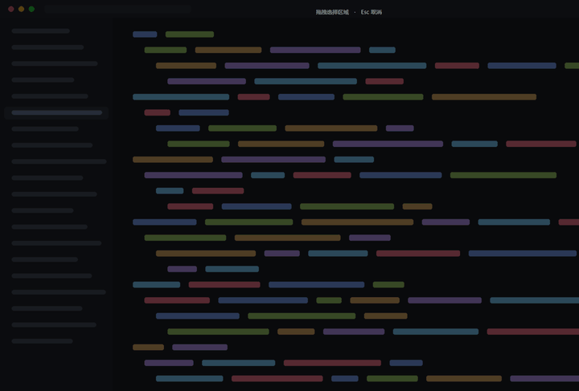

# claude-overlay

**An always-on-top floating window for talking to Claude — type your question, or select any part of your screen and ask about it.**

English · [中文](README.zh-CN.md)




---

## The idea

Sometimes the thing you want to ask about is *right there on your screen* — an error message, a chart, a piece of UI that looks wrong. Screenshotting it, saving it, finding it, attaching it, then switching to a chat app is a lot of steps for a question you'll forget by the third one.

`claude-overlay` collapses that into: **press one key, drag a box, type.**

It stays out of your way as a small translucent window pinned on top of everything else — no taskbar entry, no window chrome, no alt-tabbing.

## Features

| | |
|---|---|
| **Always on top** | Borderless, translucent, draggable. Never gets buried. |
| **Type to chat** | Streamed answers, with conversation context kept between turns. |
| **Select and ask** | Press <kbd>·</kbd> (the key left of <kbd>1</kbd>). The screen dims, your selection stays bright, then just type your question. |
| **Full-resolution capture** | The image sent to the model is the real screen pixels, not a downscaled preview. |
| **Redo the selection** | Not happy with the box? Drag a new one — nothing is locked in until you send. |
| **Conversation history** | Conversations survive a restart — both the transcript and Claude's memory of it. New chat, switch and delete from the ≡ panel. |
| **Remembers your look** | Background colour and opacity are saved to `config.json`. |

## Requirements

- **Python 3.10+** (required by `claude-agent-sdk`)
- **Windows** — the window focus handling uses Win32 APIs directly
- A Claude-compatible endpoint reachable with a token in `~/.claude/settings.json`

## Quick start

```bash
pip install -r requirements.txt
python overlay.py
```

Then either **type a question and press Enter**, or **press <kbd>·</kbd> and drag a box** first.

## Usage

### Asking about something on screen

1. Press <kbd>·</kbd> — the whole screen dims, but **your selection stays at full brightness**.
2. Drag out a rectangle. Change your mind? Just drag another one.
3. Release — the floating window jumps to the front and grabs keyboard focus.
4. Type your question, press Enter. The image goes out with it.
5. <kbd>Esc</kbd> or right-click cancels the whole thing at any point.

> **Keep the selection away from the floating window itself** — it's drawn on top of the screen, so it ends up in the capture.

### Asking about anything else

Just type. This goes through a persistent Claude session, so it keeps context across turns and can read files in the project.

### Conversations

Conversations appear as tabs under the title bar, like a browser:

- **Click a tab** to switch — each conversation keeps its own Claude context
- **`✕` on a tab** closes it (with confirmation)
- **`+`** starts a new conversation
- Closing the app keeps everything: next launch restores the last conversation, and Claude picks up where it left off

History lives in `history.json` next to the code (never pushed to the repository). Titles are derived automatically from the first question of each conversation.

These are deliberately **two separate channels** — see below.

## How it works

```
                    ┌─────────────────┐
   type + Enter ───▶│  agent.py       │  claude-agent-sdk
                    │  ClaudeSession  │  persistent, has tools, has context
                    └─────────────────┘
                    ┌─────────────────┐
  · + drag + Enter ─▶│  vision.py      │  anthropic SDK
                    │  VisionSession  │  one-shot, image + text, no history
                    └─────────────────┘
```

Screenshot questions are intentionally **one-shot**: they don't inherit or pollute the chat history. That keeps "what does this error mean?" from derailing a long coding conversation.

### Two details worth knowing

**Dimming without `-alpha`.** The obvious way to dim the screen is a translucent `Toplevel`. It doesn't work: `-alpha` applies to the *whole* window, so your selection dims along with everything else. Instead, `capture.py` takes a screenshot, darkens a copy of it, puts that darkened copy on a `Canvas` as the background, and pastes the *original* pixels back in as the selection — a bright hole cut out of a dark screen.

**DPI scaling.** On a display scaled to 125%, Tk's coordinate space and the actual screenshot pixels are **not the same thing** (2048×1280 vs 2560×1600 on the machine this was built on). `capture.py` computes the ratio at runtime as `screenshot_width / tk_screen_width` rather than hardcoding it, so changing displays or scaling needs no code changes.

## Files

| File | What it does |
|---|---|
| `overlay.py` | The floating window, hotkey handling, stage transitions |
| `history.py` | Conversation history: transcripts and session ids in `history.json` |
| `agent.py` | Text chat via `claude-agent-sdk` (streaming, keeps context) |
| `capture.py` | Full-screen region selector: dimming, bright hole, DPI conversion |
| `vision.py` | Screenshot questions via the `anthropic` SDK (streaming) |
| `test_sdk.py`, `test_vision.py` | Verification scripts for each channel |

## Configuration

`config.json` is created the first time you change the background colour or opacity from the ⚙ panel. Deleting it just resets to defaults.

`history.json` holds your conversation transcripts — it is gitignored and never leaves your machine.

Credentials are **never** stored in this repo — they're read at runtime from `~/.claude/settings.json`.

## Known limitations

- **Windows only.** The focus-stealing code uses Win32 APIs directly.
- **The floating window can end up in your screenshot** if your selection covers it.
- **First token takes 5–7 seconds** on screenshot questions — the model has to look at the image first. The chat area shows `🤖 Claude：` immediately, so it doesn't look frozen.
- **The hotkey is hardcoded** to `·` in `capture.py`. See the comments there before changing it — there are two non-obvious traps.

## Contributing

**Any kind of contribution is welcome — and that includes ideas, not just code.**

- 🐛 **Found a bug?** [Open an issue](https://github.com/winezzz999/claude-overlay/issues/new). A screenshot and what you expected to happen is plenty.
- 💡 **Got an idea?** Feature requests are genuinely welcome — including half-formed ones. "Wouldn't it be cool if…" is a perfectly good issue.
- 🗣️ **Want to talk about it?** Start a thread in [Discussions](https://github.com/winezzz999/claude-overlay/discussions). How you use it, what you wish it did, what annoys you — it's all useful.
- 🔧 **Want to write code?** Fork it, branch, and open a PR.

There are no dumb questions here. If something feels off while you're using it, that's valuable information — please say so.

If you do want to send code:

1. Create a branch: `git switch -c feature/your-idea`
2. Keep `main` working — that's the whole point of branching
3. Open a PR describing **what problem it solves**, not just what it changes

Small, focused PRs are easier to review and land faster than large ones.

## Roadmap

- [ ] **Voice input** — select a region, hold a key, speak your question; image and text go out together
- [ ] **Package as a skill** so it can be shared with VS Code extension users
- [ ] **Cross-platform support** (macOS / Linux)
- [ ] Make the hotkey configurable

Have an opinion on what should come first? [Say so in Discussions](https://github.com/winezzz999/claude-overlay/discussions).

## License

[MIT](LICENSE) — use it, change it, ship it.
